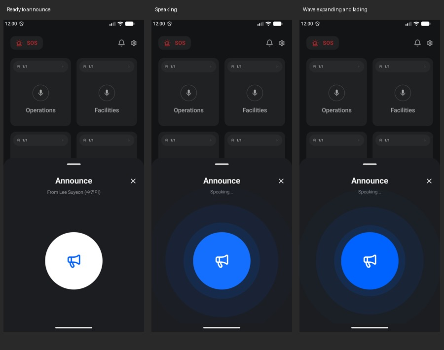

# Announcement sheet

The modal wraps its content with 20 dp side padding and 24 dp vertical padding beneath its standard drag handle. Home remains visible above it. Short screens can scroll inside a capped sheet.

| Element | Size / spacing |
| --- | --- |
| Heading | 24 sp, 28 sp line height |
| Heading to subtitle | 8 dp |
| Subtitle | 14 sp, 20 sp line height |
| Subtitle to icon wrapper | 32 dp |
| Icon wrapper | 320 dp tall |
| Circle centered in wrapper | 168 dp |
| Glyph | 44 dp; ic_announce_notactive when idle, ic_announces when speaking |

Tapping the circle toggles the existing local speaking preview. Three staggered blue waves start at the circle edge, expand outward, and fade to zero before restarting. The circle and text layout do not move. Stopping removes the pulse. The shared bottom-wave effect used by SOS is unchanged.

This screen remains a UI preview; the displayed sender name and speaking state are not connected to live announcement audio transport.

Validation: debug and instrumentation builds, lint, and the announcement emulator test passed. The test verifies wrapper height, idle/speaking states, fixed circle bounds, pulse removal on stop, and closing back to Home. Screenshots use test-only homepage data.
