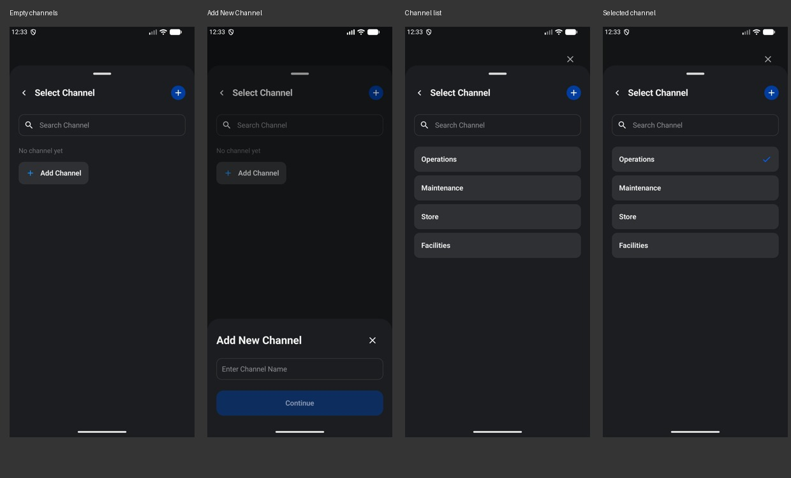

# Channel selection

The shared picker now leaves room above the sheet and uses the established 20dp side inset, 20sp navigation title, 48dp search field, 56dp channel rows, and 8dp row spacing. The selected row keeps its normal surface with a blue trailing checkmark.

Add New Channel opens as a compact sheet over the picker: 20dp side and 24dp vertical padding, a 24sp heading, a 24dp close icon, and the shared text field and Continue button. The popup has no drag handle, matching the reference. Blank names remain disabled and submitted names are trimmed. Both member setup and member details use the same content.

Screenshots are from the Android emulator at 1080 × 2400. PairingSheetFlowUiTest captures the empty picker, creation popup, populated picker, and reopened picker with a selection. It also covers direct first-channel creation, search selection, cancellation, and preserved member drafts. ManageMemberUiTest covers the member-detail integration.
