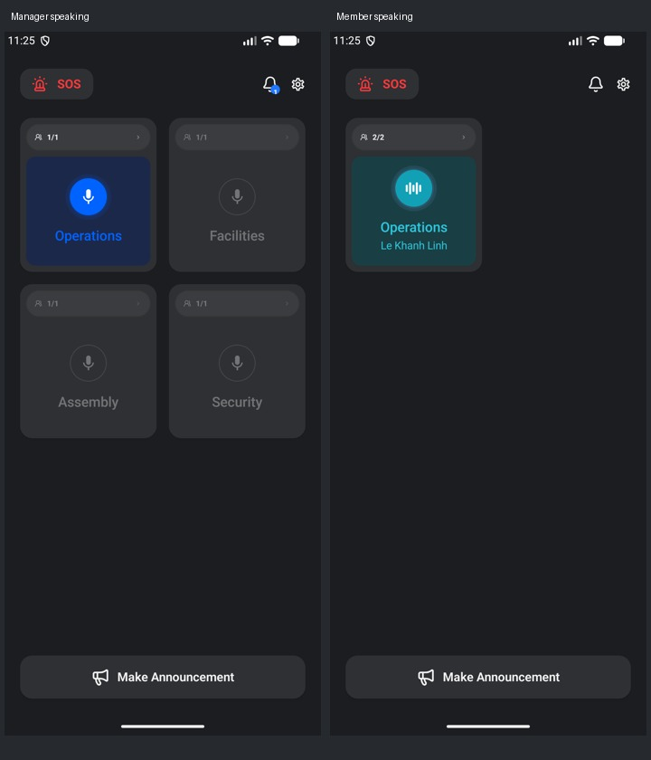

# Channel speaking states

The 200 dp card and 48 dp circle keep their existing dimensions. Two expanding/contracting halos render behind the circle at 10% opacity each, without changing the layout.

| Element | Manager speaking | Member speaking |
| --- | --- | --- |
| Panel background | `#1C284A` | `#193F45` |
| Circle | `#0062FF` | `#11A0B6` |
| Icon | White filled microphone | White supplied `ic_talk` waveform |
| Text | Existing blue channel name | `#2EC6DD` channel and speaker name |
| Halos | `#0062FF`, two at 10% | `#81B1FF`, two at 10% |

The name is taken from the channel member whose live status is `SPEAKING`. It updates when that member changes and disappears when the channel returns to idle. Long names remain on one line with ellipsis.

The homepage Make Announcement action and announcement sheet both use the supplied `ic_announces` drawable. The reusable ripple used elsewhere in the app is unchanged.

The screenshots use a test-only sample roster. Verification: debug APK build, 31 unit tests, 10 emulator UI tests, and lint with zero errors. UI checks cover changing the live speaker, returning to idle, toggling manager speech, and completing the existing tutorial. Physical badge audio was not tested in this visual refinement.
