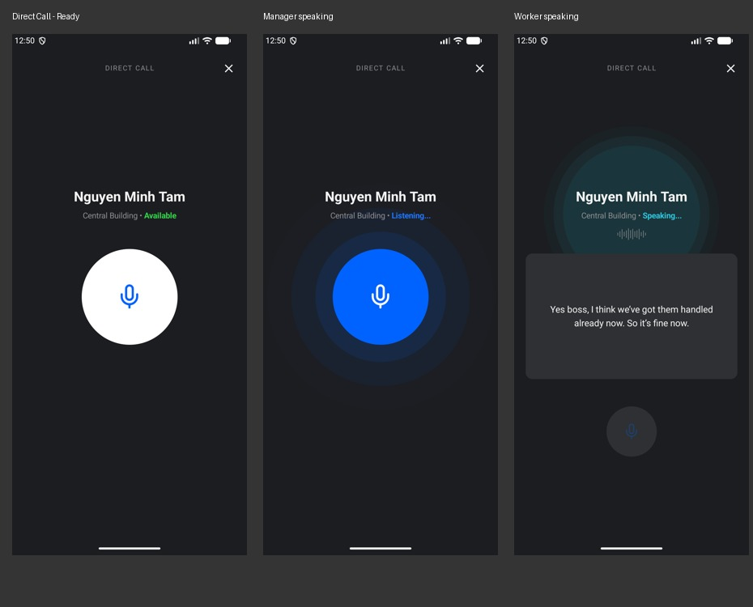

# Direct call

The existing direct-call destination now matches the idle, manager-speaking, and worker-speaking reference states. Shared spacing uses 20dp side insets and 24dp screen padding, a 24sp name, 14sp status, and a 24dp close icon. The main mic is 168dp with a 44dp drawable; the compact listening mic is 88dp with a 28dp drawable. The transcript card is 220dp tall with 16sp text and scrolls internally for long messages. The page body also scrolls on short screens or at larger text sizes.

ExpandingVoicePulse is shared with the announcement sheet. Blue rings expand and fade behind the manager mic; teal rings sit behind the worker identity. The microphone covers its rings, and identity positioning stays stable between idle and speaking.

Press starts capture and release ends/submits the turn. Cancellation, leaving the screen, or backgrounding cancels the partial turn. A microphone permission grant never automatically starts capture after the original press has ended; a new hold is required. Accessibility actions offer explicit start/stop controls. Completed translations remain visible after worker speech stops.

The user explicitly chose screen and hold-to-speak changes only. Worker interruption and firmware behavior are outside this change; the small mic stays disabled while the worker speaks. Existing voice-only, translation-progress, missing-member, and audio-error feedback remain available. Live badge audio was not tested; UI tests verify the gesture callbacks and state transitions on the emulator.

Validation: assembleDebug, assembleDebugAndroidTest, lintDebug, and 9 passing UI tests across DirectCallUiTest, AnnouncementSheetUiTest, and TeamSheetUiTest. The screenshots use fixture transcript text and the actual rendered app UI at 1080 × 2400.
