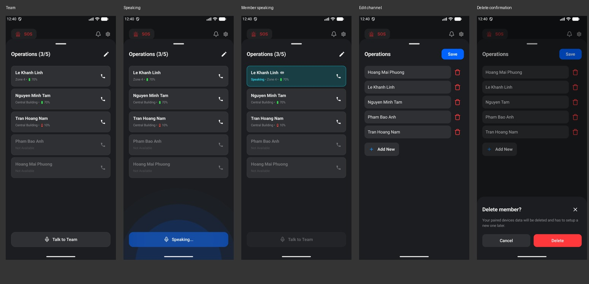

# Homepage team sheet

Home's member-count control continues to open the existing TeamSheetContent. No destination or parallel team page was added.

The sheet leaves space above it, uses 20dp side insets, a 20sp title, 16sp member names, 12sp status lines, 8dp list gaps, and a 56dp bottom action with 24dp bottom spacing. Member speech uses the same #193F45 surface, #11A0B6 outline, #2EC6DD Speaking label, and ic_talk artwork as the home speaker palette. Offline call buttons remain disabled.

Team speaking uses the shared fading blue wave behind the bottom action. A member starting to speak or entering edit mode ends the local speaking UI and requires a fresh tap to restart. This refines the existing visual state; it does not add audio transport.

Edit mode keeps draft names until Save, uses the imported trash drawable, and opens the existing ConfirmDeleteSheetContent before deletion. Cancel and Close leave the member unchanged. The shared confirmation now has 20dp side/24dp vertical padding, a 20sp title, 14sp body, 24dp close icon, and 16sp button text. Member Details receives the same shared confirmation styling.

Validation: assembleDebug, assembleDebugAndroidTest, lintDebug, and 16 passing instrumentation tests across TeamSheetUiTest, PairingTutorialUiTest, and ManageMemberUiTest. Screenshots were captured on the emulator at 1080 × 2400.

## Overlap audit — awaiting product choice

| Existing flows | Relationship | Recommendation |
| --- | --- | --- |
| Home → team sheet; Settings → Manage Channel → filtered Manage Member | Both list a channel's members. Home exposes speaking and direct calls; Settings exposes member details and search/filter. | Keep the destinations distinct unless Settings should open the team sheet too. |
| Team sheet → Edit; Member Details | Both rename/remove members. Inline team editing handles multiple names; details additionally changes channel and shows device information. They already share deletion confirmation. | Keep both entry points and share components. |
| Onboarding/demo setup; normal channel/member setup | Similar setup content, with guided progress and isolated demo behavior on one path. Real and replay onboarding share OnboardingFlowContent; setup forms and pairing content are already shared. | Preserve onboarding/demo and normal flows; do not replace them with extra copies. |

No consolidation was performed pending the user's choice. Existing unrelated OnboardingFlow edits were left untouched.
