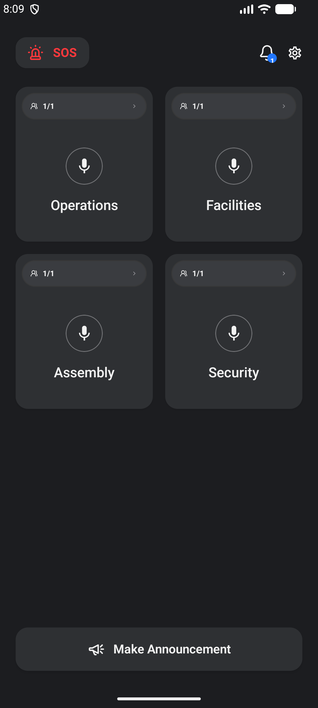
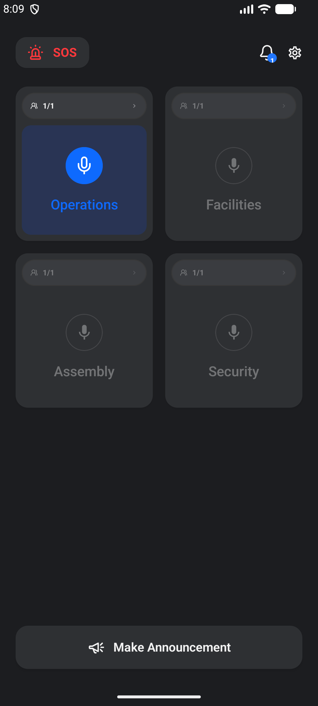

# Homepage layout refinement

The homepage uses a fixed navbar, a scrolling two-column channel grid, and an announcement button anchored at the bottom. Measurements use Android dp for layout and sp for text.

| Element | Layout |
| --- | --- |
| Screen sides / top | 20 dp / 24 dp below status-bar inset |
| Navbar → cards | 24 dp |
| SOS button | 16 dp horizontal and 10 dp vertical padding; 12 dp icon–label gap |
| Navbar icons | 20 dp; notification–settings gap 16 dp |
| Grid | Two columns; 16 dp gaps |
| Channel card | 200 dp high; 8 dp inner padding |
| Member chip | 11 dp padding on each side; 10 sp count and 10 dp icons |
| Microphone | 48 × 48 dp circle; 16 dp gap to channel name |
| Channel name | 18 sp, centered, ellipsis for long names |
| Announcement footer | 20 dp side margins; 24 dp bottom spacing plus navigation-bar inset |

The supplied `member_channel` drawable is used on both rectangular and round displays. The idle mic is filled with a visible gray circle, and settings uses an outline icon. The talking animation expands outside the fixed mic slot so it does not move the channel name.

## Emulator captures

Sample members and channels below exist only in the UI test.

| Ready | Talking |
| --- | --- |
|  |  |

## Verification

- Debug app and instrumentation APK builds succeed.
- 31 unit tests pass.
- 9 emulator UI tests pass, including the full tutorial, enlarged-text navigation, homepage notification/settings actions, mic toggle, and member-list opening.
- Lint completes with no errors; existing warnings remain.
- Refreshed tutorial screenshots are in [the tutorial gallery](../homepage-tutorial/README.md).
