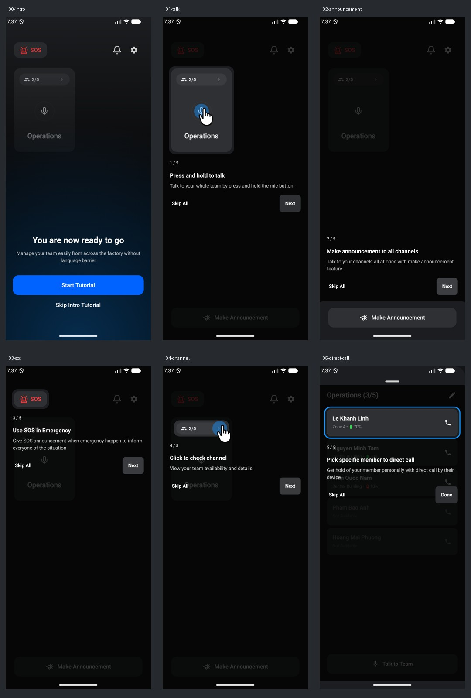
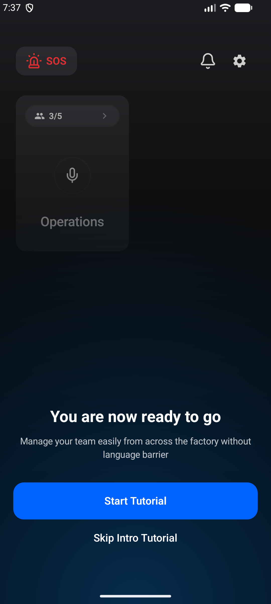
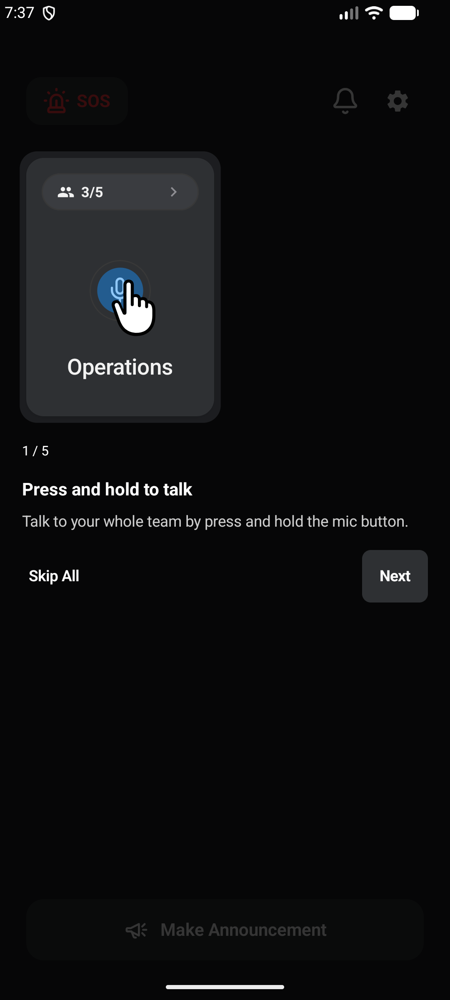
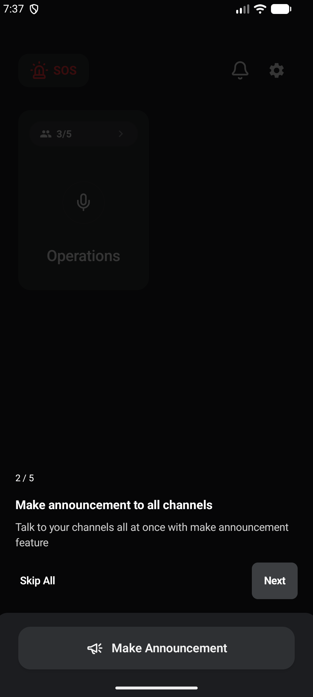
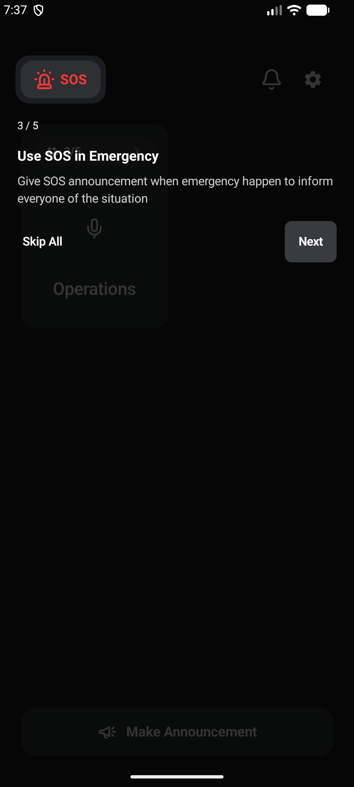
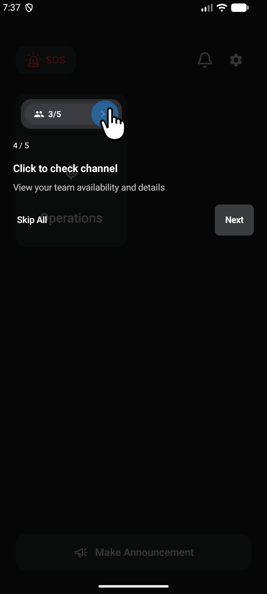
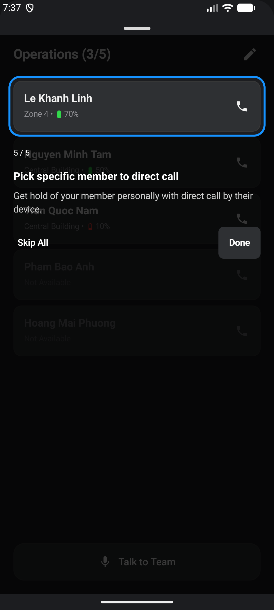

# Homepage tutorial refinement

The home intro and all five guided steps now follow the supplied layout. These are actual emulator captures with a test-only sample roster; no sample members are added to the installed app.

## Layout

Android uses dp for layout distances and sp for text so the design scales with screen density and accessibility settings.

| Element | Size / spacing |
| --- | --- |
| Intro side / bottom padding | 20 dp / 48 dp inside system safe area |
| Intro heading | 24 sp, 30 sp line height |
| Intro body | 14 sp, 20 sp line height |
| Heading → body / body → actions | 12 dp / 32 dp |
| Intro actions | Shared 56 dp primary button, 16 sp text; adjacent transparent Skip Intro Tutorial button with no border |
| Intro backdrop | Blue bottom glow using #1692FF |
| Guided step number | 12 sp, then 16 dp to title |
| Guided title | 16 sp, then 8 dp to description |
| Guided description | 14 sp, then 16 dp to actions |
| Skip All / Next / Done | 14 sp; minimum 48 dp touch targets |
| Guided copy side margins | 20 dp |

`TutorialStepContent` is shared by every guided step. Copy can scroll when enlarged text needs more space, while the actions remain reachable. The final action remains **Done** to communicate that the tutorial is finished.

The first spotlight covers the full channel card while its cursor points at the microphone. The channel-check cursor points toward the member chip's arrow. The direct-call spotlight highlights the first displayed member, with a blue outline, inside the team sheet's own window. No extra dialog sits above the sheet. Dismissing that sheet ends the tutorial.

## Screens

| Intro | Talk | Announcement |
| --- | --- | --- |
|  |  |  |

| SOS | Channel | Direct call |
| --- | --- | --- |
|  |  |  |

## Validation

- Debug app and instrumentation APK builds succeed.
- 31 unit tests pass.
- 8 `PairingTutorialUiTest` emulator tests pass, including progression through all five steps, announcement controls, enlarged-text Next/Skip, and enlarged-text intro Skip.
- Android lint completes with no errors; existing warnings remain.
- Screenshots inspected on the API 37 Medium Phone emulator.

The emulator reports a native-library 16 KB page-size compatibility notice for existing app dependencies. It was dismissed on the emulator for these captures. This UI change does not resolve native-library packaging compatibility or test voice hardware.
