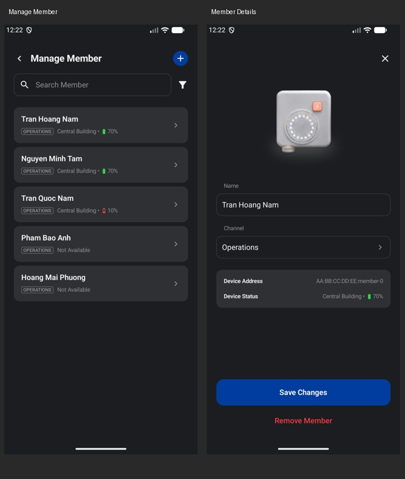

# Manage Member and Member Details

Manage Member keeps its blue header + and removes only the duplicate Add Member button from the empty roster. Demo/onboarding Add Member remains available.

Member cards now use the shared VikoListRow with a supporting-content slot: 16 sp name, channel tag, online/offline/battery status, and trailing chevron. The shared 16 dp horizontal / 15 dp vertical card padding is retained. Long channel names truncate so status and navigation remain usable. The page heading is 20 sp.

Member Details reuses the existing device illustration, labeled fields, device information card, and 56 dp VikoBlueButton with 16 sp Save Changes text. The close icon is 24 dp; content uses 20 dp sides and updated 24 dp top/bottom spacing. The form scrolls and accounts for the keyboard. Remove Member remains a red text action that opens the existing confirmation sheet.

Validation: debug and instrumentation builds, lint, and 13 emulator tests passed. Tests cover the header + / absence of the duplicate button, demo onboarding Add Member, opening details, editing name/channel and saving, removal confirmation, and the existing pairing/tutorial regressions. Captures use test-only data.
