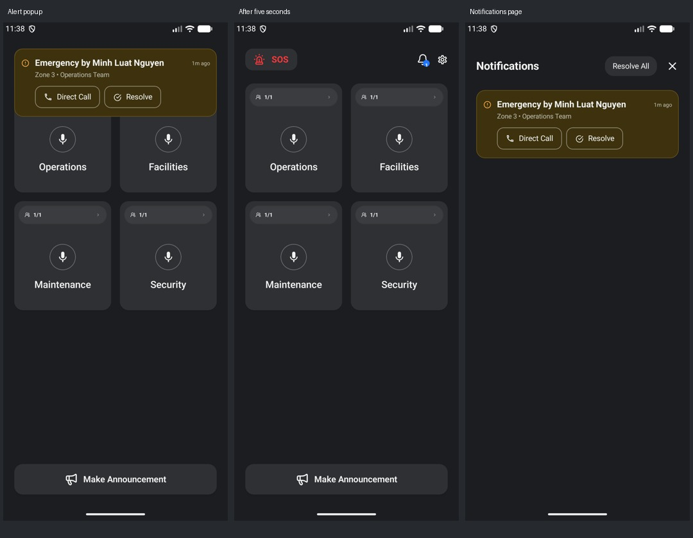

# Notification card and transient homepage banner

The same alert card is used on Home and the Notifications page.

| Element | Measurement |
| --- | --- |
| Card padding | 12 dp sides, 16 dp vertical |
| Leading information/status icon | 16 dp, supplied `ic_notif_info` / `ic_notif_done` |
| Emergency heading | 16 sp, one line with ellipsis |
| Zone / team | 12 sp |
| Time at the trailing edge | 10 sp |
| Action text | 14 sp |
| Action padding | 16 dp sides, 11 dp vertical |

The heading row has the leading status icon, flexible title, and trailing time. The detail and action rows align under the title; actions use the remaining content width and wrap on narrow screens or at enlarged font sizes.

On Home, the banner floats above the navbar and channel grid, 24 dp below the status-bar inset and 20 dp from the sides. It does not move the grid. After five seconds it hides without resolving or deleting the alert. The alert remains in the existing notification feed; tapping the banner or bell opens that page. Timeout does not automatically navigate away from Home.

These are emulator captures using test-only data. Verification: debug APK build, 31 unit tests, 13 emulator UI tests, and lint with zero errors. Tests check visibility before five seconds and disappearance afterward, unchanged card position, no resolution on timeout, notification-page availability, Direct Call / Resolve actions, and enlarged-text action visibility. The existing homepage and onboarding tests also pass.
