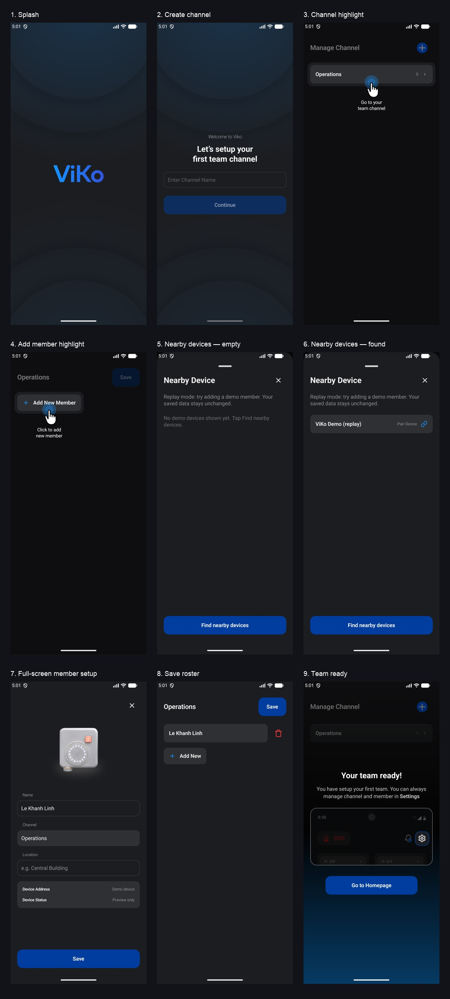

# Onboarding part 1

Android implementation of the supplied [ViKo Figma onboarding](https://www.figma.com/design/yFd1R5C73ptPAeZ8KEBwj3/OneVoice---Solution-design?node-id=1640-12010).

## Changes

- Shared splash/create-channel background: #1692FF glow, top and bottom circular layers and soft outer shadows.
- Screen content uses 20dp horizontal and 24dp vertical safe-area spacing. The channel-creation column centers in the available space and accommodates the keyboard.
- Welcome text 14sp; setup heading 24sp; page headings 20sp; row names and action text 16sp; counts and device details 12sp. Inputs use 48dp minimum height with 12dp internal padding; primary buttons are 56dp high.
- Shared `VikoListRow` gives channel, member and nearby-device rows 16dp horizontal / 15dp vertical padding. Channel counts have a 12dp gap to the chevron.
- Onboarding hides the channel search/back controls. A measured cut-out keeps the target bright under a 50% black scrim. The supplied cursor has an animated outward ripple at its fingertip.
- Bluetooth discovery remains a bottom sheet, including real permission, radio-enable, settings, retry and scan-progress actions. Device rows use `ic_link`.
- Member setup is full screen, as requested. It uses the exported Figma wearable illustration, 16dp form section gaps, pinned Save, and a Done keyboard action. Location and Wi-Fi configuration remain available because the wearable needs them during BLE provisioning.
- Saving a member in onboarding closes setup and returns to the channel roster. The roster uses `ic_trash` with removal confirmation. Saving a nonempty roster returns to Manage Channel with the Team Ready overlay and the supplied `onboarding_setting` artwork. Creating a channel alone no longer shows Team Ready.
- **Settings → Replay onboarding** runs the same visual journey with an explicitly labelled demo device. It never writes to the channel/member repositories or invokes Bluetooth provisioning. The entered replay data survives activity recreation within the flow.

The existing app font family is retained. Android dp/sp implement the supplied Figma px sizes while respecting screen density and accessibility font scaling. Discovery uses a 24sp title and 16sp body, matching the supplied frame (the request's sentence listed these two sizes in both orders).

## Screenshots

These are app screenshots from an API 37 emulator, not Figma mockups. Pairing screenshots show **replay mode**, so the demo badge is not evidence of a physical BLE connection.

| Screen | Screenshot |
| --- | --- |
| Splash | [01](screenshots/01-splash.png) |
| Create channel | [02](screenshots/02-create-channel.png) |
| Highlight channel | [03](screenshots/03-manage-channel.png) |
| Highlight Add New Member | [04](screenshots/04-add-member.png) |
| Discovery empty | [05](screenshots/05-pairing-empty.png) |
| Discovery results | [06](screenshots/06-pairing-found.png) |
| Full-screen setup | [07](screenshots/07-setup-member.png) |
| Channel roster | [08](screenshots/08-members.png) |
| Team Ready | [09](screenshots/09-team-ready.png) |

## Validation

- Debug APK and instrumentation APK build successfully.
- 31 unit tests pass, including actual-vs-replay persistence, channel-creation failure/retry, restored replay state and the member-before-ready requirement.
- 10 emulator UI checks pass across the onboarding and pairing/tutorial suites: complete replay, screenshots, large-text reachability, Bluetooth prerequisites/search, tutorial completion and portrait orientation.
- Android lint reports no errors. Existing dependency-update, compatibility and resource warnings remain.
- Physical BLE provisioning and Wi-Fi voice were not exercised in this UI refinement. Their transport protocol and firmware are unchanged.

Install `app/build/outputs/apk/debug/app-debug.apk`, then open **Settings → Replay onboarding** to inspect without clearing app data. Tap **Find nearby devices** to reveal the replay badge, enter a member name, save the member, then save the roster.
