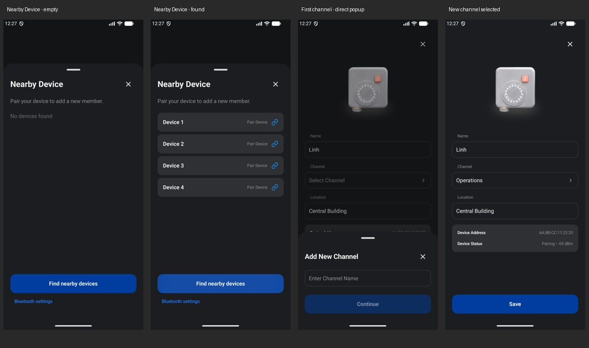

# Pairing sheet and first-channel setup

Nearby Device uses 85% of the available height instead of filling the screen. The shared discovery content applies this to real pairing and demo replay, while retaining scrollable results and the existing scan, Bluetooth, permission, and Done actions.

In Setup Member, tapping Channel with no channels opens the existing Add New Channel bottom sheet directly over the form. Creating the channel selects it and preserves the member name and location. When channels already exist, the normal Select Channel picker is used. Preset channels remain locked.

The Add New Channel component's styling is unchanged pending the next design refinement. BLE and Wi-Fi provisioning are unchanged.

Validation: debug and instrumentation builds, lint, and 13 emulator tests passed. Integration checks use in-memory repositories and a fake scanner to verify sheet bounds, accessible scan actions, direct creation and selection of the first channel, preserved member drafts, and the existing-channel path. Existing pairing/tutorial UI regression checks also pass. Screenshots use test-only data, without physical badge pairing.
