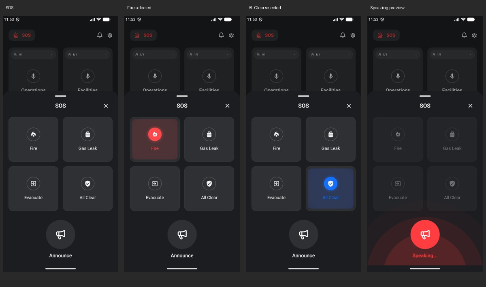

# SOS bottom sheet

The SOS modal wraps its content and leaves Home visible above it. Its content is capped at 78% of the display height, with scrolling available on smaller screens or with larger text. The modal host supplies the drag handle and system insets.

- Two columns of 160 dp emergency cards, without the channel member-count row.
- Selected emergency types reuse the animated `ChannelSpeakingPulse` behind a 48 dp circle; emergency types are red and All Clear uses the existing blue panel and accent.
- Heading: 20 sp. Close icon: 24 dp.
- Grid to Announce: 32 dp.
- Announce: 104 dp circle, 38 dp `ic_announces`, 12 dp gap to its 18 sp label.
- Tapping Announce shows the red bottom wave and Speaking label, and dims/disables the four emergency cards. Tapping again stops the preview. The existing 3.5-second automatic stop remains.

This is the existing local UI preview; this screen does not send emergency audio or packets to badges.

Actual emulator captures with test-only homepage data. Validation: debug and instrumentation builds, lint, and the SOS interaction test passed. The test checks selection changes, Announce start/stop, disabled cards while speaking, stable grid position, and closing back to Home.
